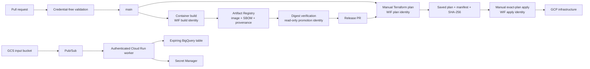

# Cloud Infrastructure Automation Lab

A personal DevOps automation lab demonstrating infrastructure delivery, least-privilege identity, immutable plan/apply handoff, container promotion, and an event-driven serverless workload on Google Cloud.

The implementation is GCP-specific, but the engineering patterns are deliberately transferable: short-lived CI identity, remote state ownership, separated plan/apply permissions, immutable artifacts, explicit promotion, operational runbooks, and bounded-cost infrastructure.

## What this demonstrates

- **Terraform / IaC** with reusable modules, remote GCS state, state-ownership rules, native Terraform tests, and destructive-change guardrails.
- **GitHub Actions CI/CD** with credential-free PR validation and owner-dispatched cloud workflows.
- **OIDC / Workload Identity Federation** instead of long-lived cloud keys.
- **Separate plan, apply, build, and promotion identities** with narrowly scoped IAM.
- **Exact-plan apply**: a reviewed saved plan is checksummed, transferred as an artifact, verified, and applied without replanning.
- **Immutable container promotion** by registry digest with BuildKit SBOM/provenance evidence.
- **Event-driven architecture**: GCS object finalization -> Pub/Sub -> authenticated Cloud Run -> BigQuery metadata row.
- **Secret Manager** for runtime configuration without putting secret values into Terraform state.
- **Operational safety**: scale-to-zero services, short retention, one-instance limits, versioned state, `prevent_destroy`, and documented recovery procedures.
- **Tests and runbooks** for infrastructure, application behavior, release verification, smoke testing, and state ownership.

## Architecture



## Delivery model

The repository intentionally separates validation, planning, applying, image building, and image promotion.

```text
Pull request
  -> fmt / init / validate / Terraform tests / Python tests / container tests

Owner dispatch from main
  -> short-lived WIF plan identity
  -> saved binary plan + rendered plan + manifest + SHA-256
  -> separate owner-dispatched apply workflow
  -> pre-auth artifact/source/digest checks
  -> short-lived WIF apply identity
  -> apply the exact reviewed binary plan
  -> post-apply zero-drift check

Container release
  -> build once
  -> attach SBOM + provenance
  -> resolve immutable registry digest
  -> verify digest/evidence with read-only cloud identity
  -> open release PR without rebuilding
  -> normal Terraform plan/apply path deploys the digest
```

## Repository layout

```text
.
|-- .github/workflows/
|   |-- validate.yml
|   |-- terraform-plan.yml
|   |-- terraform-apply.yml
|   |-- container-build.yml
|   `-- container-promote.yml
|-- bootstrap/foundation/          # state, WIF, IAM and Artifact Registry foundation
|-- environments/lab/              # deployable lab root
|-- modules/
|   |-- github-oidc-wif/
|   |-- guarded-storage-bucket/
|   `-- event-metadata-worker/
|-- services/event-metadata-worker/ # Flask worker and tests
|-- scripts/                        # bootstrap and immutable release verification
`-- docs/runbooks/                  # operator-focused procedures
```

## Safety boundaries

This is a personal lab, not a production reference architecture. It uses synthetic data only.

Key rules:

1. One physical resource has exactly one Terraform state owner.
2. Imports require an ownership preflight; an existing resource is not assumed to be unmanaged.
3. PR validation does not receive cloud credentials.
4. Cloud workflows use short-lived federated identity; no service-account key is stored in GitHub.
5. Plan and apply identities are distinct.
6. State buckets are versioned, private, soft-delete protected, and guarded with `prevent_destroy`.
7. Expensive always-on services are intentionally excluded from the lab.
8. Secret values are created outside Terraform state and read only at runtime.

## Validation

The local/CI validation surface is intentionally credential-free:

```bash
terraform fmt -check -recursive
terraform -chdir=modules/github-oidc-wif init -backend=false
terraform -chdir=modules/github-oidc-wif test
terraform -chdir=bootstrap/foundation init -backend=false
terraform -chdir=bootstrap/foundation test
terraform -chdir=modules/event-metadata-worker init -backend=false
terraform -chdir=modules/event-metadata-worker test
terraform -chdir=environments/lab init -backend=false
terraform -chdir=environments/lab test
python3 -m unittest discover -s scripts/tests -v
python3 scripts/worker_release.py verify-release \
  --release environments/lab/worker-release.json
docker build --target test services/event-metadata-worker
```

These checks validate configuration shape and safety contracts. They do not authorize deployment or prove live cloud state.

## Why GCP?

This was built in an existing personal GCP sandbox because that was the cloud environment available for hands-on experimentation. The main purpose is the automation/control model rather than a provider-specific product list. Equivalent patterns map naturally to AWS concepts such as GitHub OIDC -> IAM roles, S3/DynamoDB-style state locking strategies, ECR digest promotion, and workload deployment to ECS/EKS.

## Selected design decisions

- **No long-lived CI credentials.** GitHub OIDC is restricted to the intended repository/workflow context.
- **No implicit apply on merge.** Infrastructure mutation requires a separate manual action and exact-plan verification.
- **Build once, promote by digest.** Promotion verifies evidence instead of rebuilding an image.
- **Bounded blast radius.** Custom IAM roles and conditions restrict automation identities to the lab resources they need.
- **State is an operational asset.** Ownership, bootstrap, recovery, and migration rules are documented explicitly.
- **Cost controls are architectural.** Scale-to-zero, retention windows, maximum instances, and excluded services reduce risk beyond budget alerts.

## Public copy sanitization

This repository is the public portfolio copy of a hands-on lab. Cloud project IDs, project numbers, bucket names, and the checked-in worker release record use non-production example values; live sandbox identifiers and historical build/run metadata are intentionally omitted.

Credential-free validation is runnable as published. Cloud-mutating workflows preserve the delivery and identity controls, but the example GCP identifiers must be replaced deliberately before using them against a private sandbox.

## Documentation

- [`docs/architecture.md`](docs/architecture.md) - detailed architecture and delivery design
- [`docs/runbooks/manual-plan-apply.md`](docs/runbooks/manual-plan-apply.md) - exact-plan handoff
- [`docs/runbooks/container-promotion.md`](docs/runbooks/container-promotion.md) - immutable image promotion
- [`docs/runbooks/state-ownership.md`](docs/runbooks/state-ownership.md) - state ownership and recovery
- [`docs/runbooks/synthetic-smoke-test.md`](docs/runbooks/synthetic-smoke-test.md) - end-to-end verification

## Scope

This repository intentionally does **not** try to demonstrate every platform technology. It focuses on a small system with enough moving parts to exercise real DevOps concerns: identity, state, delivery, IAM, container provenance, event-driven runtime behavior, observability, recovery, and safe change control.
